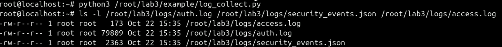
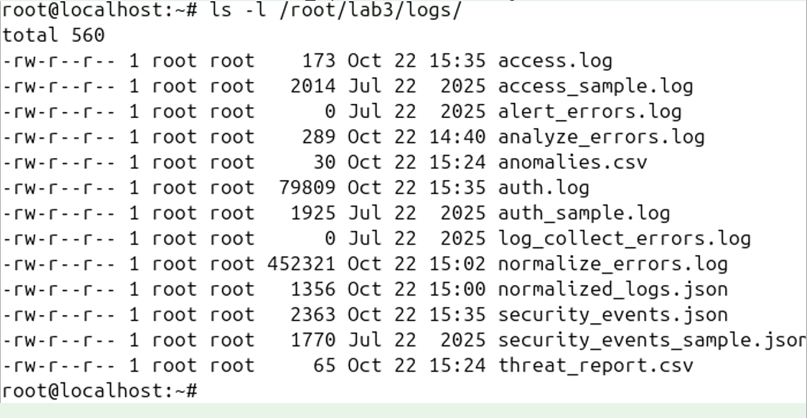
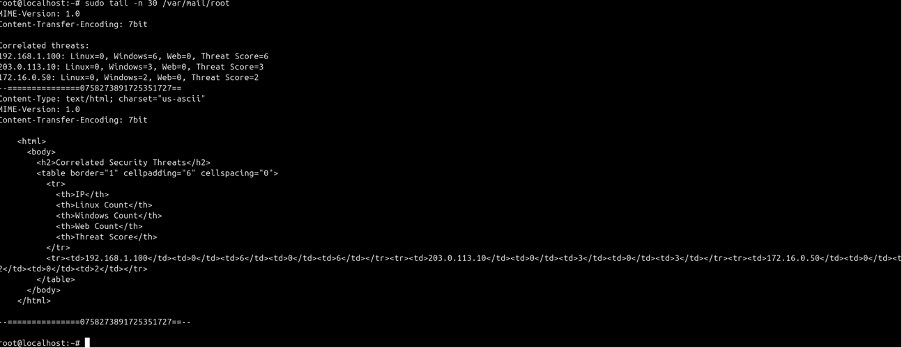
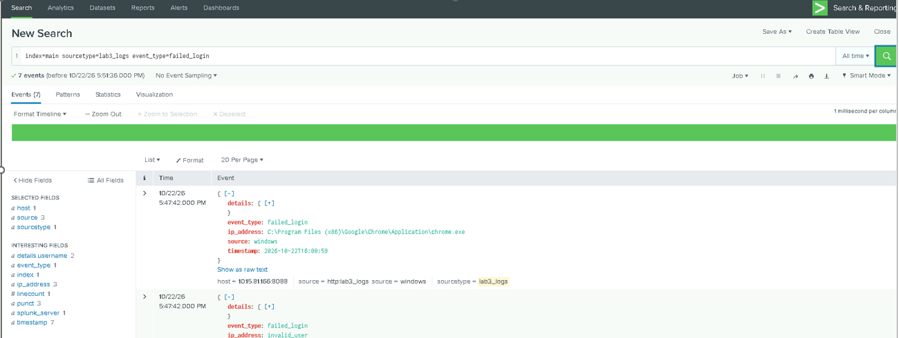
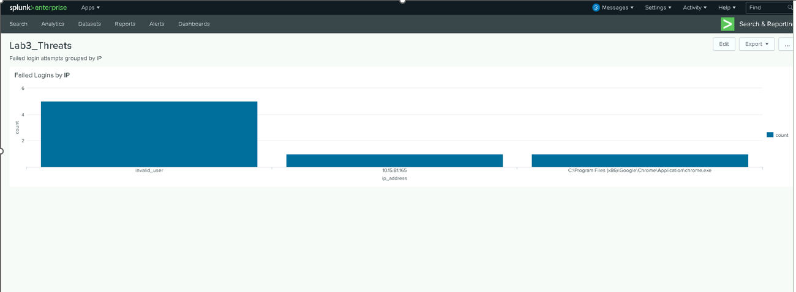
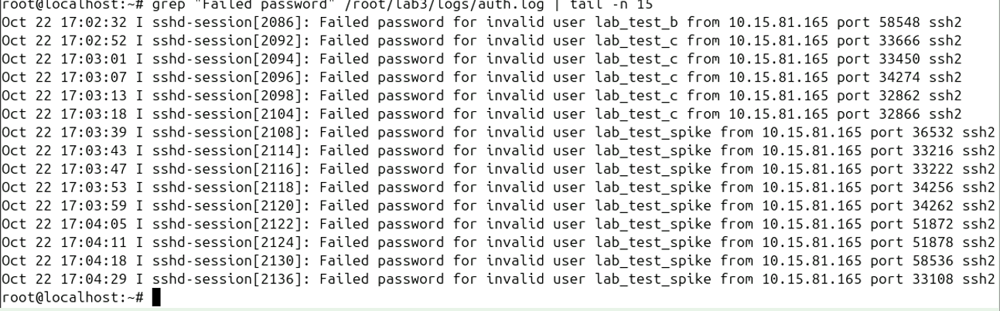
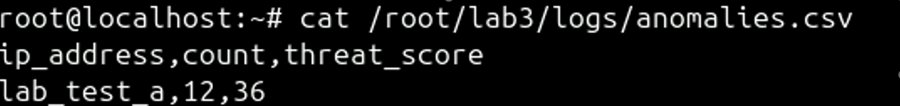

# Comprehensive Automated Log Analysis System

## Project overview

I built a lab system that collected logs from Linux, Windows, and a web server, converted them into a common format, searched for suspicious patterns, and sent results to Splunk and a local email alert.

---

## 1. Windows scheduled log export

Created a Windows Scheduled Task to run `export_events.ps1` every five minutes. The task appears as Ready, showing that it was registered and available to run.

---

## 2. Automated log collection

Ran `log_collect.py` on Ubuntu and verified that the Kali authentication log, Windows security events, and web access log were present.

---

## 3. Collected and processed log files

Verified that the source logs and analysis outputs were present in `/root/lab3/logs/`, including the normalized logs, threat report, and anomaly report.

---

## 4. Automated email alert

Reviewed the local email alert generated by the analysis script. It summarizes the correlated threats so an operator can see which activity needs investigation.

---

## 5. Splunk log-ingestion search

Searched Splunk for failed-login events indexed as `lab3_logs`. The search returned seven matching events.

---

## 6. Splunk threat dashboard

Created the `Lab3_Threats` dashboard in Splunk with a bar chart showing failed login counts by IP address.

---

## 7. Generated SSH test activity

Reviewed the Kali authentication log after generating failed SSH login attempts from the Ubuntu lab system. The entries show that the test events were recorded.

---

## 8. Anomaly detection results

Reviewed the anomaly report generated by the Isolation Forest model. It flagged `lab_test_a` with 12 events and a threat score of 36.

---

## 9. Normalized log data

The `log_normalize.py` script converted collected Linux and web events into a consistent JSON format. The records include timestamps, event types, source details, and usernames for analysis.

[View the normalized log data](data/normalized_logs.json)

---

---

## 10. Threat report

The `log_analyze.py` script applied correlation rules to the normalized events and saved the results in `threat_report.csv`. The report summarizes repeated failed-login activity by source/account label and includes a threat score.

[View the threat report](data/threat_report.csv)

---

## Challenges, lessons learned, and improvements

### Challenges

I had to troubleshoot network access between the Ubuntu, Kali, and Windows systems. Splunk’s HTTP Event Collector (HEC) connection also required checking the endpoint, port, firewall access, and token. I corrected script and data issues as I tested the collection, normalization, and analysis steps.

### What I learned

I learned how to collect logs from Linux and Windows, normalize different event formats, search for failed logins in Splunk, and generate reports and email alerts. I also learned that automated results depend on accurate parsing and valid data. For example, malformed field values can affect how events appear in a dashboard or report.

### What I would improve

I would add stronger input validation and clearer error handling to the scripts, test log parsing against more varied examples, and verify the normalized output before sending it to Splunk. I would also keep credentials and tokens outside source files and use redacted sample data in a public portfolio.
