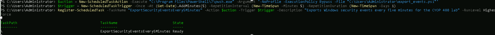

# Comprehensive Automated Log Analysis System

## Project overview
I built a lab system that collected logs from Linux, Windows, and a web server,
converted them into a common format, searched for suspicious patterns, and
sent results to Splunk and a local email alert.

### 1. Windows scheduled log export

Created a Windows Scheduled Task to run `export_events.ps1` every five minutes. The task appears as Ready, showing that it was registered and available to run.

